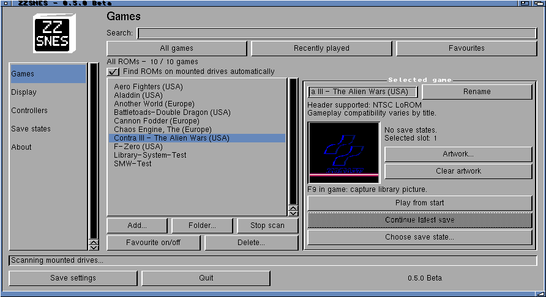
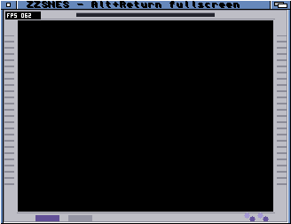

# ZZSNES — 0.5.0 Beta

A native **MUI** game library for **AmigaOS and ZZ9000**, using **PocketSNES / Snes9x2002**
and **[Xanxi’s XACP platform](https://github.com/Xanxi-Amiga/XACP-ZZ9000)**.
The Cortex-A9 runs emulation and fullscreen rendering. The 68k handles AmigaOS,
files, controls, display coordination and batched AHI audio.

**[Download 0.5.0 Beta](https://github.com/SkiltonUSA/ZZSNES-ARM-68K/releases/tag/v0.5.0-beta)** ·
[User guide](docs/current-guide.md) · [Changes](CHANGELOG.md) ·
[Build and measurements](docs/current-development.md) · [Interface gallery](docs/current-interface.md)

## Features

- ZZDosBox-style sidebar: Games, Display, Controllers, Save states and About.
- Original logo, Workbench icon, startup panel and loading panel with controls.
- Add ROMs or folders; search, favourites, recent games and captured artwork.
- Rename titles and delete games with confirmation.
- Automatic ROM discovery on mounted Workbench volumes, including USB storage.
- Fullscreen or Workbench window; **Alt+Return** switches during play.
- Optional FPS overlay and **Classic, Soft or Gradient** software scanlines.
- Monitor aspect correction, borders, overscan masks and joystick testing.
- Five save slots per game; save, load, resume and delete.
- Guarded NEON stores and scanline dimming, with an integer fallback.

Save-state previews include miniature screenshots.

## Requirements

- **ZZ9000** with compatible **XACP firmware**; tested on **XX19c / XACP 1.7**.
- **Picasso96**, **AHI**, and **MUI 3.8 or compatible**, installed separately.
- A writable application drawer and your own ROMs.
- AmigaOS: tested on **3.2.3** with a TF4060-equipped A4000TX.

The SNES core reserves 32 MiB of ZZ9000 RAM, plus display and OS allocations.
Only one Core1 application can run at a time.

## Performance

The established steady emulation measurements remain:

| Game / emulator | Steady emulation FPS |
| --- | ---: |
| Contra — ZZNES | **59.893** |
| Super Mario World — ZZSNES | **59.920** |

Repeated 600-frame comparisons measured **16.9% less ARM presentation time with Soft scanlines**.
Plain output retains the faster existing STMIA copy path.
These are presentation-stage savings, not equivalent increases in game FPS.
[Method, raw logs and limitations](docs/current-development.md).

## Compatibility and credits

Automatic PAL/NTSC timing for supported standard SNES cartridges.
[Cartridge restrictions and tested games](docs/amiga-zzsnes-pal-compatibility.md).
Audio: 32,040 Hz stereo through AHI.

Development: **Codex assisted, Amiga-Bridge MCP**. Interface: **MUI**.
Thanks to **Xanxi** for XACP, and the **PocketSNES / Snes9x2002** contributors for the core.
The software scanline effects and NEON presentation work are shared with ZZDosBox;
they do not require the separate ZZ9000 scanline application or an FPGA change.

Component licences and notices are included. The Snes9x core is non-commercial.
