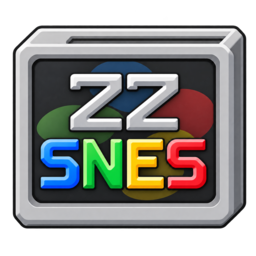
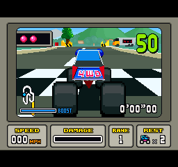
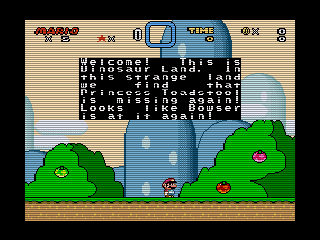
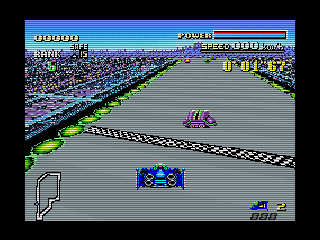
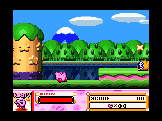
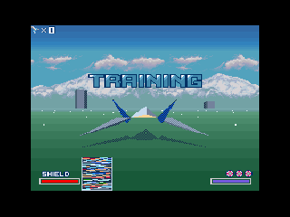
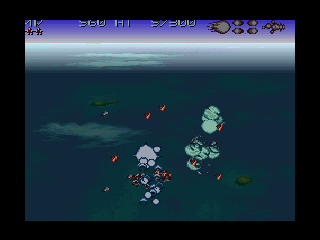

# ZZSNES — 0.7.4 Beta

A native **MUI** game library for **AmigaOS and ZZ9000**, using **PocketSNES / Snes9x2002**
and **[Xanxi’s XACP platform](https://github.com/Xanxi-Amiga/XACP-ZZ9000)**.
The Cortex-A9 runs emulation and fullscreen rendering; the 68k handles AmigaOS,
files, controls, display coordination and batched AHI audio.

This beta needs **96 MiB of allocatable ZZ9000 RAM**, plus display and AmigaOS memory.

**[Download 0.7.4 Beta — installer or ZIP](https://github.com/SkiltonUSA/ZZSNES-ARM-68K/releases/tag/v0.7.4-beta)** ·
[Installation](docs/package-manager.md) · [User guide](docs/current-guide.md) ·
[Changes](CHANGELOG.md) · [Interface gallery](docs/current-interface.md)

App version: **0.7.4-dev**.

## Super FX compatibility

Super FX cartridge emulation runs on the ZZ9000 Cortex-A9. **0.7.4 Beta** fixes
Super FX RAM mapping, instruction execution, pixel transparency and colour-window
handling, correcting the missing geometry and distorted race colours in
**Stunt Race FX** without modifying the ROM.

The race, save/load and window/fullscreen switching were checked on the A4000TX.
Star Fox 2 and Doom also passed native save/load replay checks. Compatibility
varies by title; **FX3 remains experimental**.
[Fix details and validation](docs/stunt-race-fx.md).

## Features

- Resizable MUI sidebar with Games, Display, Controllers, Save states, Disks, ROM Manager and About; compact, scrollable layout for 640×480 screens.
- Colour logo, Workbench icon, startup and loading panels with keyboard controls.
- Raw ROMs and single-ROM ZIP archives (stored/deflate), without an external unpacker.
- Search, favourites, history, captured artwork, Add, Rename and confirmed Delete.
- Scan a selected folder, SD card or USB drive once to import ROMs.
- No fixed library-entry cap; tested with 20,000 entries.
- ROM Manager: bulk import, duplicate-entry cleanup with progress/cancel, and verified backups to disk or USB. Duplicate cleanup keeps ROM files and saves.
- Fullscreen or Workbench window, with **Alt+Return** switching during play.
- **F7** scanline control: Xanxi FPGA effects in fullscreen; Soft software filtering in a window.
- Optional FPS overlay, aspect correction, border artwork, overscan masks and **F9** screenshots.
- Automatic per-app ZZ9000AX audio with AHI unit 0 fallback; system preferences stay unchanged.
- Five save-state slots per game, with save, load, resume and delete.
- Joystick testing and live ZZ9000 temperature beside the version.
- ROM region and target beside the preview: PAL **50 fps**, NTSC **59.92 fps** pacing.
- Save-state thumbnail previews and automatic SRAM battery-file persistence on clean exit.
- Per-game display, emulation, controller and cheat profiles.
- Fixed or automatic frameskip, adjustable audio low-pass filtering, transparency and emulated CPU timing settings.
- Two-player keyboard/gamepad mapping and up to 32 Game Genie / Pro Action Replay codes per game.
- Expanded SA-1, DSP-1, C4, S-DD1 and Super FX support; experimental FX3 and 512-pixel high-resolution output.

## Specifications

| Component | Specification |
| --- | --- |
| Core | PocketSNES / Snes9x2002 |
| Emulation processor | ZZ9000 Cortex-A9 / ARMv7-A, application-owned Core1 via XACP |
| Host processor | 68020 instruction set; AmigaOS, files, input, display coordination and AHI |
| Owned ZZ9000 RAM | 96 MiB, including 32 MiB executable reserve; plus display/OS allocations |
| ROM formats | .sfc / .smc; single-ROM .zip |
| Audio | 32,040 Hz stereo, automatic ZZ9000AX AHI output, unit 0 fallback |
| Display | Picasso96 fullscreen or Workbench window; optional scaling, borders and FPS |
| Scanlines | Fullscreen FPGA Classic / Soft / Gradient; windowed ARM Soft |
| ROM size | Up to 6 MiB; above 4 MiB requires supported S-DD1 or ExHiROM mapping |
| Save states | Version 3 with expanded chip state; version-2 standard states remain readable |

## Requirements

- Zorro III Amiga with **ZZ9000**, configured ZZ9000 Fast RAM and compatible **XACP firmware**. Tested on **XX19c / XACP 1.7**.
- **AmigaOS 3.x**, **MUI 3.8 or compatible**, **Picasso96 API v2+**, **AHI v4+** with an installed output driver and configured unit 0.
- A writable application drawer and your own ROMs; only one Core1 application may run at a time.
- The offline installer also needs **C:lha** and **C:IconX** for Workbench launch.

**A TF4060 or 68060 accelerator is not required.** A faster 68k benefits files,
window updates and audio servicing. The tested system is an A4000TX with
TF4060/68060 and AmigaOS 3.2.3; 68030 performance has not been measured.

## Installation

Choose **`-beta-amipkg.lha`** for the offline installer, or **`-beta.zip`** for
manual copying. Both contain the same matched launcher and players, licences
and scanline tools; neither includes ROMs or Amiga system libraries.

Extract the installer, open its drawer and double-click **Install**. It checks
MUI, Picasso96, AHI and ZZ9000 availability, lets you choose a destination, and
adds missing Xanxi scanline tools. Existing settings, ROMs and saves are preserved.
[Installer details and upgrade limitations](docs/package-manager.md).

## Scanlines

**Soft scanlines and fullscreen are enabled by default.**

Fullscreen uses **[Xanxi’s FPGA scanline interface and tools](https://github.com/Xanxi-Amiga/zz9000-scanlines)**;
a Workbench window uses **our ARM Soft software routine**, shared with ZZDosBox.
The effects do not run together. **F7** cycles Off → Soft → Gradient → Classic
in fullscreen and toggles Off/Soft in a window.

Both downloads bundle **ZZScanlines**, **ZZScanlinesGUI**, **Install-Scanlines**,
source and GPL notices. Existing controls are preserved. **Compatible FPGA
scanline firmware is required**; installing tools does not add firmware support.
The emulator controls the interface directly, so the separate utility need not run.
Hardware scanlines are disabled on normal exit. [Controls and installation](docs/scanline-install.txt).

F9 cannot capture hardware scanlines, which are applied after framebuffer readback.
These earlier gameplay captures show the **software** effect:

| Super Mario World | F-Zero |
| --- | --- |
|  |  |

## More games

320×240 gameplay captures from ZZSNES on the A4000TX/ZZ9000.

| Kirby Super Star | Star Fox — training | Axelay |
| --- | --- | --- |
|  |  |  |

## Performance

| Game / emulator | Measured steady emulation FPS |
| --- | ---: |
| Contra — ZZNES | **59.893** |
| Super Mario World — ZZSNES | **59.920** |

The current build includes the O2 core build, faster ARM presentation, guarded
NEON software dimming, optional NEON smooth scaling and audio-aware frameskip.
Plain copies retain the faster STMIA path. Earlier repeated 600-frame comparisons
measured **16.9% less ARM presentation time** with Soft software scanlines.

These are presentation-stage savings, not equivalent game-FPS gains or new
measurements of this release. [Measurements](docs/current-development.md) ·
[Optimisation work](docs/optimisation-20261018.md).
The FPS overlay counts emulated frames; frameskip can reduce distinct pictures shown.

## Compatibility

Special-chip support varies by title. SA-1 and DSP-1 have game tests; C4 and
S-DD1 integration has synthetic regression coverage. FX3 and high-resolution
output remain experimental; interlace uses bob/line doubling. No full-speed or
universal compatibility claim is made for these families.
[Expanded cartridges and validation](docs/expanded-cartridges.md) ·
[Profiles, SRAM, input and cheats](docs/additional-options.md).

Battery SRAM saves on **clean exit**, not periodically. New option-bearing states
require the new player. The second physical controller still needs gameplay
validation; recorded functional tests include some audio gaps.

## Credits and source

Development: **Codex assisted, Amiga-Bridge MCP**. Interface: **MUI**.
Thanks to **Xanxi** for XACP and the FPGA scanline tools, and the **PocketSNES / Snes9x2002**
contributors for the emulation core. ZIP loading uses Mark Adler’s **puff** from
zlib. The offline installer uses **[amipkg](https://github.com/thomas-luebker/amipkg)**,
with the documented local fixes originally used by ZZDosBox.

The Snes9x core is non-commercial. Component licences, source pins and notices are included.
[Release build inputs](docs/release-build.json) · [Third-party notices](THIRD_PARTY.md).

## Translation and audio

[32 MiB register-JIT experiment](docs/jit-register-experiment.md): the dispatch
regression is fixed in the tested Super Mario World workload—11.65% less ARM
core time than the earlier translator. This beta includes the limited register dispatch; it is not a full guest JIT.

Experimental audio handoff results are included in the same report.

[Controlled audio scheduling tests](docs/fixed-presentation.md) found no repeatable gain; release scheduling stays unchanged.

[Fullscreen polling experiment](docs/ack-polling.md) reduces reads of the flip acknowledgement register by about 90%, without a proven FPS gain. Original release polling remains unchanged.

[Pixel-conversion overlap tests](docs/conversion-overlap.md) passed correctness checks but ran slower overall. Existing release scheduling remains the default.

[AHI and bitmap-lock profiling](docs/host-service-profiling.md) led to the per-app AX backend below. Four-frame batching showed no FPS gain; the three-frame default stays.

[Per-app ZZ9000AX audio tests](docs/ax-audio.md) measured **3.2% higher FPS for NES / 4.6% for SNES** in matched short runs. This beta includes the AX backend; the figures are game-specific test results.

[Single-core raster experiments](docs/ppu-profiling.md) found **0.54% less ARM
core time in Star Fox 2** from reusing PPU work. Combining sprite batching,
fixed-colour blending and PPU changes gave no core-time gain in the three tested
workloads. These variants remain experimental; 0.7.4 keeps its existing renderer.
