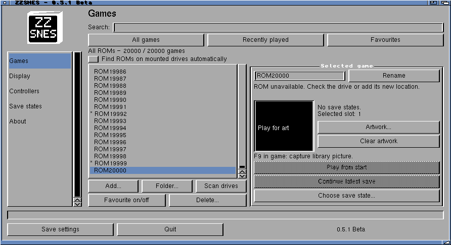
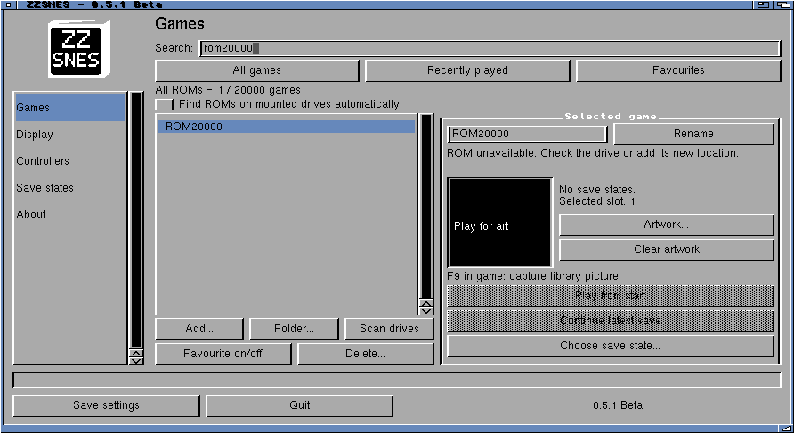

# Large library verification

Synthetic paths only; no ROM data. Each launcher loaded 20,000 entries, selected
the last entry, and saved a byte-identical configuration (MD5 checked) on exit.
The 128-entry cap has been removed rather than raised. Native tests cover search,
filters, title changes, history, removal, duplicates and allocation failures.
The player/ARM executable is unchanged. No emulation performance claim is made.

Live MUI search was verified on the final build: `rom20000` selects one entry
from 20,000 without pressing Return. Earlier builds revealed missing MUI
Contents notifications; polling with a typing delay and an Acknowledge handler
resolved that issue. Final transfer and saved-settings checksums were verified.

