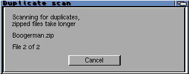

# Duplicate-scan progress window

Launcher-only follow-up to the scalable development build. Installed in
SD032G:Emulator/ZZSNES; previous executable retained in Rollback-scan1019.

Shows “Scanning for duplicates, zipped files take longer”, current filename,
File X of Y, and Cancel. The filename is announced one event-loop turn before
reading/decompressing the ROM. The panel closes before removal confirmation.
No duplicate-matching or file-deletion policy changes.

Physical compact 640×480 window-budget probe: panel 310×122, filename-before-read,
cancellation, restart and cleanup passed. Production settings unchanged across
replacement/reopening. No gameplay, display mode or firmware changes.
The NES probe covered unreadable-file handling; the SNES probe decoded two ZIPs.
The SNES probe exceeded the initial 45-second harness wait; it subsequently
completed normally with no unreadable entries. This UI change does not accelerate
ZIP decompression. Cancel is processed between complete ROM reads.

Native large-library/migration sanitizer and layout tests passed; m68k builds
passed with warnings as errors. Existing published packages/tags are unchanged.

Binary: 259152 bytes; SHA256 `21bae9d7b25675763808f306764bb4bfc105d2c50497b56387fc257c4e78b952`.
