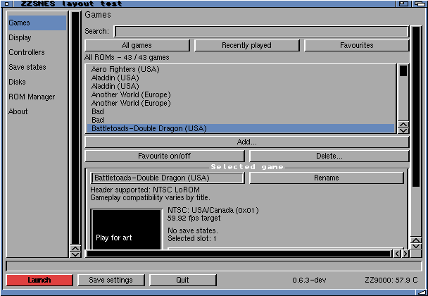
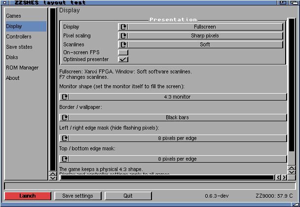
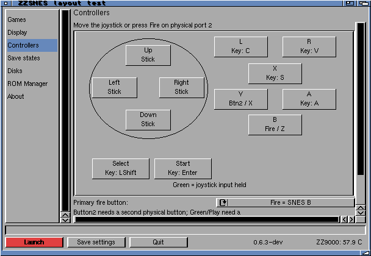

# ZZSNES 0.6.3-dev — scalable launcher

The full ZIP contains the updated launcher with the previous verified players,
Xanxi scanline tools, installer and licenses. No ROMs, saves or personal settings
are included. `build.json` records source/compiler inputs and executable identity.

[Interface and build guide](../../../docs/scalable-launcher.md).

## Validation

- Warnings-as-errors m68k build; native screen budgets and wrapping checks pass.
- 20,000-ROM library and legacy-settings migration tests pass under sanitizers.
- Physical MUI checks on the existing 1920×800 Workbench: all seven pages,
  scroll bounds and loading card pass for 640×480, 800×600 and 1024×768 window budgets.
- Live resizing to 480×360, 608×360 and 768×360 passes.
- Opening at the 640×480 budget produces a 608×420 window with a 462×318
  viewport. All seven compact pages fit horizontally; longer pages scroll vertically.
- Opening after an 800×600 run exposed MUI restoring a larger remembered window.
  The first-open clamp fixes this; both larger-to-smaller regression checks pass.
- Compact loading card: 267×123; regular loading card: 395×178.
- Two packaging runs match byte-for-byte. Only launcher, readme, version and
  checksums differ from the previous development ZIP; player/tool bytes match.

Tests constrain windows on the physical Amiga; they do not change Workbench
screen mode or establish execution at an actual 640×480 desktop resolution.
No ARM worker or game was started. Probe settings are private copies; ROM paths
were rebased for read-only cartridge inspection. No game performance claim follows.

The source checksum audit found stale manifest entries for previously committed
source updates (listed in build.json). Those source entries were reconciled
against the existing Git HEAD; archived release-binary checksums were retained.

Reports: [640](layout640.log), [800](layout800.log), [1024](layout1024.log).

Production launcher installed with a rollback copy. Installed checksum matches;
Library.cfg stayed byte-identical across replacement and reopening. Existing
players, ROMs, states, startup files and Workbench screen settings were retained.
