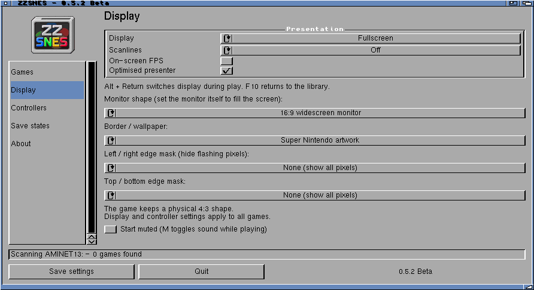
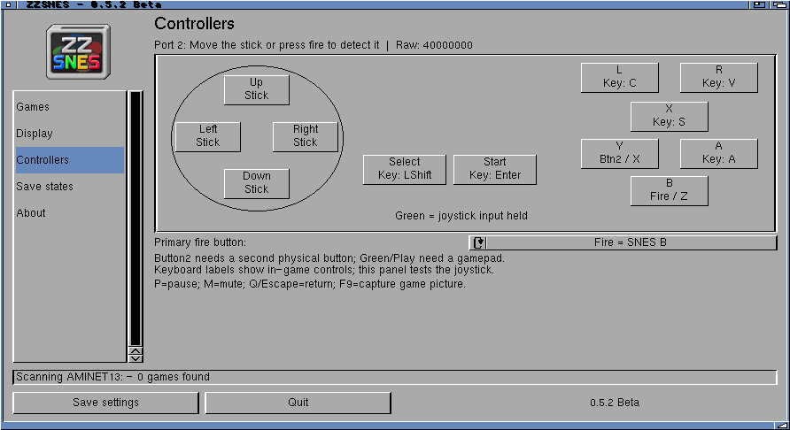
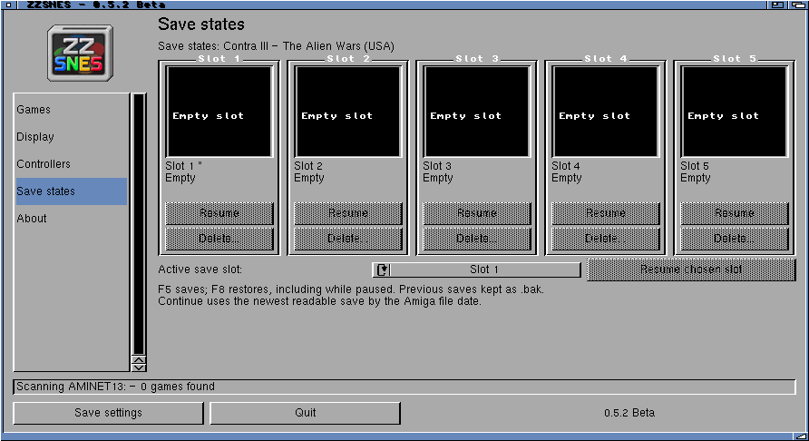
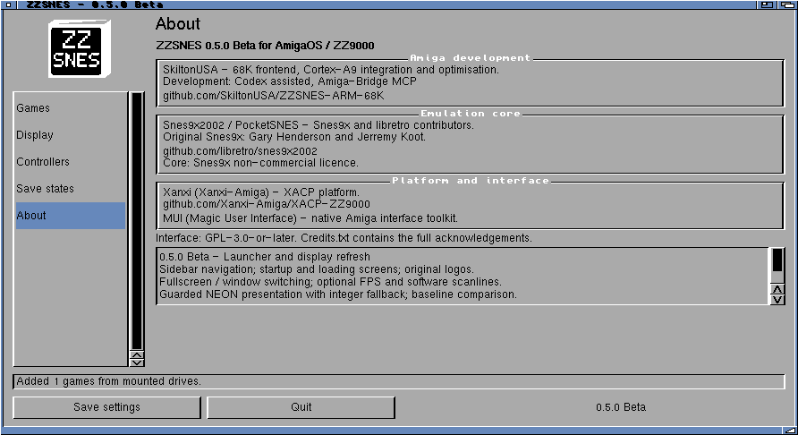

# ZZSNES interface

## Games

## Display

## Controllers

## Save states

## About

## Large libraries

[20,000-entry check on the Amiga](../amiga/records/2026-10-16/large-library/README.md).

## Games with Soft scanlines

Amiga/ZZ9000 framebuffer captures from **0.6.2-dev**, fullscreen with Sharp pixels.

| Super Mario World | F-Zero |
| --- | --- |
|  |  |
