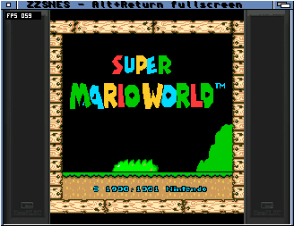

# EmuELEC bezel — ZZSNES 0.6.1 Beta

Both supplied 1080p PNGs have identical outer side panels. The 1px and 2px
scanline overlays differ only inside the game area. This update samples the
frame once and leaves scanlines to the existing independent display control.
It does not attempt to reproduce 1080p overlay spacing at 320×240.

The converter scales each side to 40×240 and packs a shared 16-colour palette.
The table uses 9,632 bytes. Palette quantisation is a deliberate compromise to
fit the existing NES image area; the first full RGB565 table failed the linker
bound. No memory-region boundaries were moved. ROM/core compatibility is unchanged.
The border width follows the existing aspect setting; NES 4:3 has no side margin.

Native sanitizer tests cover theme persistence, unchanged game geometry, panel
bounds and output alpha. Existing relocated ARM presenter comparisons passed.
Physical checks cover a bounded ZIP session, window/fullscreen switching,
paused save/load, artwork capture and clean teardown on A4000TX. The NES return
to window needed a mouse click to focus it before F10 was delivered; exit then
completed normally. No presentation-speed improvement is claimed.

Source masters and converter: [snapshot](../development/borders-20261016/borders/).
