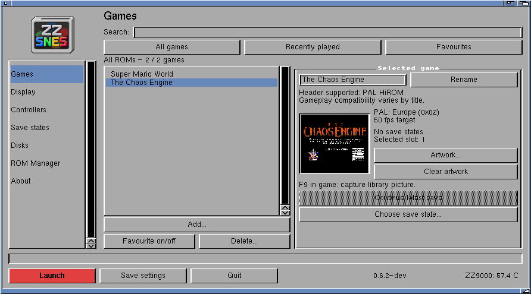
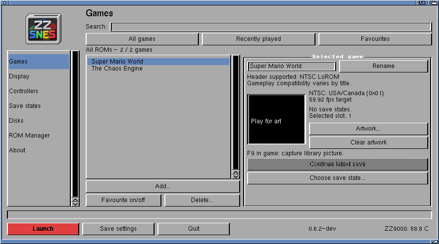

# SNES region and output cadence

The development launcher reads destination byte +0x19 from the validated
LoROM/HiROM header (after stripping a 512-byte copier header when present).
It displays the destination name, code and target beside the selected game's
picture. ZIPs are inspected through the existing bounded ROM loader. Super FX
headers use the same display, retaining their compatibility warnings.

| Region | Output period | Target |
| --- | ---: | ---: |
| PAL | 20,000 microseconds | 50 fps |
| NTSC | 16,689 microseconds | 59.92 fps |

These are emulation pacing targets, not guaranteed displayed FPS. The player
can omit presentation of late pictures while still running every CPU/APU frame.
The existing supported-region and mapper gates are unchanged.

## Why this change

The owner's Chaos Engine cartridge has a HiROM header with destination **0x02**,
Europe/PAL. The previous installed player correctly reported PAL, with a
19,873-microsecond period (about 50.32 fps). The report of noticeably fast play
was **not reproduced as a PAL ROM running at NTSC speed**. The rate correction
alone is only about 0.64%; it cannot explain a 20% speed-up.

The former host limiter subtracted two frame periods from its deadline. The
new limiter waits to the regional deadline without that lead. Small scheduling
jitter is compensated on the existing timeline; a delay over one full frame
rebases the clock to avoid a long catch-up burst. A screenshot/state operation
can reset the next frame's schedule without cancelling the current frame's wait.

The same region period drives the host/ARM handshake and libretro audio output
sample calculation. AHI remains 32,040 Hz stereo. This avoids generating the
old 50.32-Hz quantity of audio while pacing at 50 Hz. CPU/PPU instructions, ROM
bytes and state layout have not changed. The NTSC period retains the pinned
core's approximate near-60 cadence; this is not a new cycle-accuracy claim.

## Verification

- Native header/label checks: accepted region codes, LoROM/HiROM, copier headers,
  and FX warning path; deadlines through timer wrap, resets, stalls and jitter.
- Existing native core/state and 20,000-entry library checks pass.
- Both ARM players: PAL/NTSC periods, 100-frame PCM totals and exact state replay
  at two relocation addresses. PAL produces 64,079 samples versus a mathematical
  64,080 (fractional accumulator rounding); NTSC 53,471 versus 53,471.556.
- Relocated presentation checks retain reference pixels, NEON/fallback register
  restoration, cancellation and mapping revocation.

Rebuild with `python3 scripts/build_current.py --arm --optimisation --core-o2`
and add `--superfx` for the supplemental player. `make test-region-pacing`
checks the scheduler and header labels; `tests/amiga/pocketsnes/check_region_arm.py`
accepts either rebuilt ELF and requires Unicorn and llvm-nm.

Physical runs and final binary identities are recorded alongside this report.
Short runs include a startup screenshot and cannot be used as steady gameplay
FPS measurements. The on-screen FPS counter measures displayed pictures, not
necessarily the number of emulated frames. PAL content on a near-60-Hz display
can still show uneven motion even when emulation is correctly paced.

### A4000TX checks

| Player / display | Cartridge | Emulated frames | Period | Audio samples |
| --- | --- | ---: | ---: | ---: |
| Standard / fullscreen | The Chaos Engine (PAL) | 600 | 20,000 us | 384,479 |
| Standard / window | The Chaos Engine (PAL) | 600 | 20,000 us | 384,479 |
| Standard / fullscreen | Super Mario World (NTSC) | 600 | 16,689 us | 320,829 |
| Supplemental FX / fullscreen | The Chaos Engine (PAL, standard cartridge) | 300 | 20,000 us | 192,239 |

All runs completed queued/submitted PCM, display acknowledgements, register/MMU
restoration, cache witness and owned-memory release without reported errors.
Audio gap counters were 5, 1, 1 and 0 respectively; zero gaps throughout playback
is not claimed. The supplemental-player check exercises its region path, not a
new Super FX game-compatibility claim. Test copies kept production ROMs and saves
untouched. [Raw records](../amiga/records/2026-10-18/region-pacing/).
