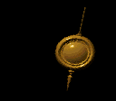
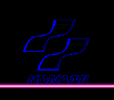

# Bounded SNES candidate checks

The isolated clipped-tile candidate completes **900 frames each** of Chrono
Trigger, Contra III, Super Mario World, Stunt Race FX and Doom. Windowed and
fullscreen presentation are covered. [Results and executable identity](summary.json).
The installed/public **0.7.12 Beta** binaries remain unchanged.

All five runs have zero display faults, framebuffer readback checks, successful
ARM return, restored registers/cache witnesses and released memory. Preview
capture succeeds for all five. Games use separate media copies, so their normal
SRAM files and launcher metadata are not changed.

These are startup/intro checks without gameplay input. They do not prove the
race section of Stunt Race FX or scrolling scenes in Chrono Trigger are correct.
The original clipping oracle remains the correctness test for partial flipped
tiles; ARM's original in-place byte swap was already correct.

Audio buffers all complete with no device error, but queue starvation is present
and counted in the summary. This is **not** an audio-quality acceptance or a
matched performance comparison. Verification readbacks and automatic preview
writes are included in the timings. Do not use these timings as normal-game FPS.

The first harness expected the NES player's completion label in the SNES log.
Chrono Trigger had actually exited successfully; correcting that label allowed
the completed run to be recorded and testing to continue. No restart was needed.

## Startup thumbnails

These are the player's 128×112 previews, not full-resolution gameplay captures.

[Follow-up without periodic verification](../../audio-without-verification/README.md)
records zero startup queue starvations for these five titles. The prior diagnostic
counts above must not be treated as production audio measurements. Star Fox 2
remains a separate sustained-workload problem.
