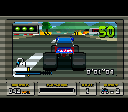

# 0.7.13 release validation

The final candidate combines corrected portable flipped-tile masks and the row
renderer. It does not change timing, audio synthesis, Super FX budgets or skip
pictures. The GSU counter experiment remains opt-in.

- Native ASan/UBSan: synthetic raster/depth/window checks and 3,600 matching
  video/PCM frames for each of five supplied games, with corrected clipping on
  both comparison sides. ROM order/hashes are in rom-identities.json.
- Exact candidate Cortex-A9 model: 120 frames each from Stunt Race FX race and
  Star Fox 2 checkpoints match video, stereo PCM and serialized GSU state against
  the corrected baseline at two candidate relocation addresses.
- Independent pixel/depth oracle compiled from this candidate: 6,336 ARM cases.
- Fresh ARM/68k build and artifact SHA-256 checks pass. See build.json.

Reproduce native comparisons with `scripts/test_ppu_experiment.py --clip-fix
--mode rows --frames 3600 --rom <supplied-rom>`. Use test_ppu_arm.py and
 test_clipped_tiles_arm.py with the recorded candidate directory for ARM checks.
No ROMs, audio recordings or save states are distributed in these records.

## Final candidate hardware checks

Six 1,800-frame startup/intro runs cover Chrono Trigger, Contra III, Super Mario World, Stunt Race FX, Star Fox 2 and Doom, alternating fullscreen/windowed output.

Each run verifies normal return, register/cache-witness restoration and owned-memory release. See [results](hardware/summary.json); audio queue counts remain recorded, including failures to sustain delivery. These are not full-game or listening claims. Hardware retained 800 MHz KEEP.

## Matched row-rendering comparison

At 800 MHz, paired 1,800-frame runs used the same private media, Normal guest
CPU, legacy Super FX timing, Paula 22,030 Hz, no periodic pixel verification and
no scanlines. Stunt Race FX used a window; Star Fox 2 used fullscreen. Sampled
video hashes match at frames 1, 600, 1,200 and 1,800.

| Game | Baseline core time | Row core time | Reduction | Baseline / row starvation events |
| --- | ---: | ---: | ---: | ---: |
| Stunt Race FX | 13.839 s | 13.459 s | 2.75% | 51 / 50 |
| Star Fox 2 | 31.806 s | 31.020 s | 2.47% | 415 / 401 |

Single matched pairs, not repeated medians or a general FPS claim. Elapsed time
was 33.742 / 34.066 seconds for Stunt and 43.563 / 43.226 seconds for Star Fox 2.
The core-time reduction does not resolve audio delivery gaps. Doom also recorded
239 starvation events in its longer candidate run; it has no new matched
baseline measurement here. [Exact results](hardware/matched.json).

The earlier 18,000-frame correction-only Stunt run's full log was recovered after
correcting Mac bridge file-response parsing and capped-read handling. It returned
normally with clean register/cache/memory teardown, but 1,056 audio starvation
events. It is neither an audio pass nor evidence of a crash from the screenshot
request. The final row build is identified separately in build.json.

## Physical race lifecycle

The exact row build resumes a prior Stunt Race FX race checkpoint, receives
acceleration/steering input, pauses, saves and reloads, switches window →
fullscreen → window with scanlines, then exits through F10 after 311 frames
(before its 3,000-frame bound). A fresh process resumes the newly saved state
for another 120 frames. Both restore registers/cache witnesses and release
memory. Window software scanlines and fullscreen hardware scanlines are recorded
in the first log. Heavy-scene audio starvation remains; intentional pause time
also appears in silence accounting.

This is the player's 128×112 preview captured on hardware, not a full-resolution
Workbench screenshot. It shows the race colours after the correction. Logs:
[race lifecycle](hardware/race-1.log), [fresh resume](hardware/race-2.log).

## Installer and installed-player checks

Fresh and repeat signed AmiPkg installs pass dependency checks, archive signatures,
binary hashes and exact README matching. The production update preserves the
recorded library, audio and controller settings; ROMs and saves are not replaced.
The installed player completes a 120-frame Chrono Trigger startup in fullscreen
with zero starvation/device errors and clean register/cache/memory teardown.
See [installation records](installation/) and [installed-player log](hardware/installed-snes-chrono.log).
Core1 is idle and Core0 AGA inactive; KEEP 800 MHz is unchanged.
Listening acceptance was deferred by request. These short checks do not establish
long-session or every-game audio quality. Package receipts describe archive-build
validation; the physical installation evidence is recorded separately here.
